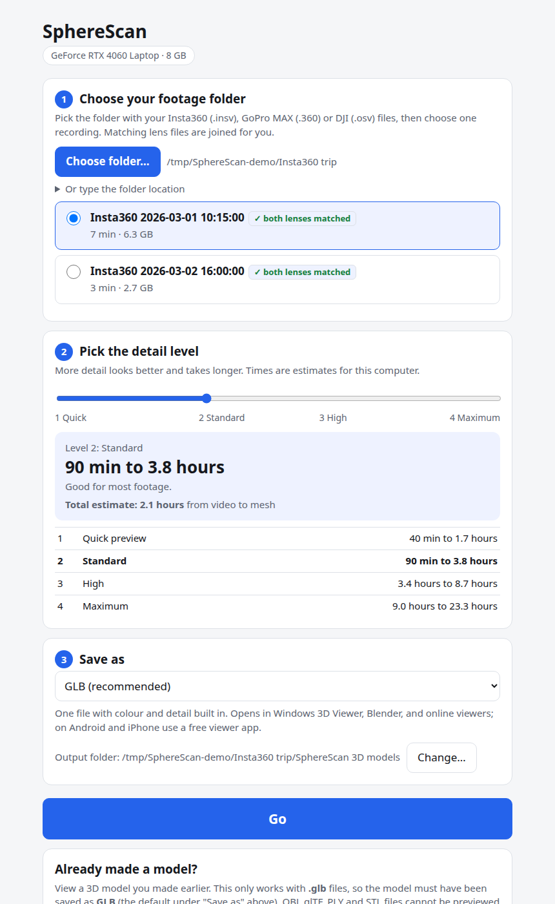
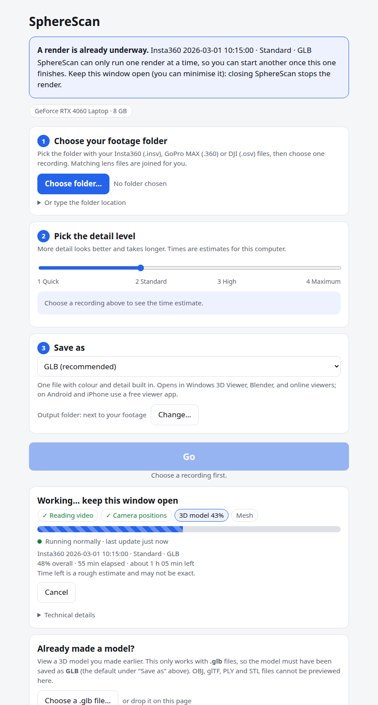

# SphereScan

Turn footage from your 360° camera into a 3D model you can spin around.

You choose a video, move a slider, and press **Go**. SphereScan does the rest.

> **Early version.** Ready-made downloads are not published yet. Until they are, someone technical needs to set it up
> (see the [developer notes](docs/DEVELOPERS.md)). Everything below describes how it works once it is running.

## What it looks like

Everything is on one page. Choose your footage, slide the detail level, and the time estimate for your computer updates as you go.

While it works, a bar shows how far along it is, what it is doing, and roughly how long is left.

## What you need

- A Windows, Mac or Linux computer **with a graphics card**. Gaming and creator laptops are fine. Very basic or very old computers may be too slow or may not work.
- A recording from an **Insta360** (`.insv`), **GoPro MAX** (`.360`) or **DJI 360** (`.osv`) camera.
- **Patience.** Making a 3D model takes hours, not minutes. SphereScan tells you roughly how long before you start.

## How to use it

1. **Open SphereScan.** It opens in its own window, like any other app. (It only runs on your own computer. Nothing is uploaded.)
2. **Choose your footage folder.** Pick the folder your camera files are in, then pick **one** recording from the list. If your camera saved two files for one recording, SphereScan joins them for you.
3. **Slide the detail level.** 1 is fastest, 4 is best quality. The page shows how long each level should take on *your* computer.
4. **Press Go.** A bar shows how far along it is and roughly how much time is left. **Keep SphereScan's window open** (you can minimise it). Closing it stops the render. Also keep the computer on, awake and plugged in.
5. **Look at your model.** When it finishes, it appears on the page. Drag to turn it, scroll to zoom.

Your model is saved in a folder called **SphereScan 3D models**, next to your footage.

## Tips for a good result

- Start with **level 1** to check your footage works. Then try a higher level.
- Plug your laptop in and stop it going to sleep while it works.
- Close other programs, especially games, video calls and browsers with many tabs. They compete for the graphics card.
- Slow, steady footage of a place or object works best. Fast shaky movement gives messy models.

## Opening your model later

Your model is a **.glb** file. To look at it again, scroll to the bottom of SphereScan and use **Already made a model?** You can also open `.glb` files in Windows 3D Viewer, Blender, or free viewer apps on your phone.

## If something goes wrong

| What you see | What to do |
|---|---|
| "Spirula Studio is not installed" | SphereScan is missing a part it needs. Re-download SphereScan, or ask the person who set it up. |
| "No recordings found" | You picked the wrong folder. Pick the folder that contains the `.insv`, `.360` or `.osv` files (a folder inside it is fine). |
| "Your graphics card ran out of memory" | SphereScan already retries with less detail by itself. If it still stops, close other programs and press Go again, or choose a lower detail level. |
| "Nothing has happened for a few minutes" | It may just be slow on a hard step. Wait a while longer. If you give up, press **Cancel** and try level 1. |
| You refreshed the window by accident | Nothing is lost. The window picks up where the render was. |
| You closed the window during a render | Closing SphereScan stops the render, so it has to be started again. SphereScan asks you to confirm before closing while a render is running. |
| The estimate was wrong | Estimates are rough and get better after each run on your computer. |

## Do I have to install it?

No. There is no installer, and it is **portable**. Unzip the download anywhere (your desktop, a USB stick, a shared folder) and open SphereScan. Next to it you will find a file called `portable.txt`. While that file is there, SphereScan keeps everything it needs in a `SphereScan-data` folder beside the app and leaves the rest of your computer alone. Copy the whole folder to take it with you. Delete `portable.txt` if you would rather it used your normal user folder.

Good to know:
- Your finished models are saved next to your footage, not in the app folder.
- SphereScan needs a graphics driver and a browser on the computer you run it on (Edge, Chrome or similar; Edge comes with Windows).
- It unpacks itself into the computer's temporary folder while running and cleans that up when you close it.
- If the folder is read-only (or a Mac moved the app into quarantine), SphereScan quietly uses your normal user folder instead.

## About

SphereScan is free software (GNU GPL v3). It includes an unmodified copy of [Spirula Studio](https://github.com/harry7557558/spirula-studio), which does the heavy lifting. SphereScan is independent and is not made or endorsed by Spirula Studio, Insta360, GoPro or DJI. Those names belong to their owners and are used only to say which files work.

Licences and where to get the source code: [THIRD_PARTY.md](THIRD_PARTY.md). For developers: [docs/DEVELOPERS.md](docs/DEVELOPERS.md).
